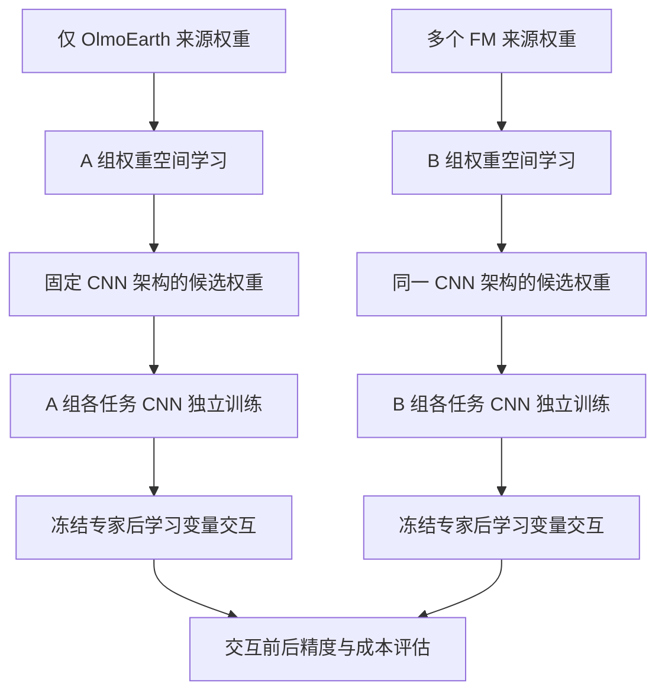

> 历史记录：不作为当前执行依据。最新入口见 [当前文档](../README.md)。

# 小型 CNN 独立专家的单源与多源权重空间迁移实验

日期：2026-10-17。状态：方案，尚未实现或提交训练。

本方案比较两种参数知识来源：仅 OlmoEarth，以及包含 OlmoEarth 的多个 Foundation Model（FM）。
两组最终均使用同一种小型新 CNN 架构，每个任务拥有独立的完整模型参数和优化状态。
FM 用于离线权重空间迁移，不作为专家的在线编码器，也不需要在最终推理时运行。
本次仅新增方案文档；现有模型、训练配置、数据和 HPC 作业不变。

## 1. 已确认的设计与研究问题

用户确认的设计是：

1. 专家是统一架构的小型新模型，首选 CNN，不是多套 OlmoEarth 骨干或 FM 上的任务 adapter。
2. A 组仅从 OlmoEarth 来源的参数中学习初始化；B 组从多个 FM 来源的参数中学习初始化。
3. 两组使用同一种权重空间迁移方法，最终生成相同 CNN 架构的权重。
4. 每个任务的 CNN 参数独立更新，损失独立优化；统一代码与模型结构不意味着共享参数。
5. 独立专家训练完成后，再训练变量交互模块，保留独立预测供比较和回退。

主要假设：在 CNN 架构、训练自由度、数据和预算相同的条件下，多 FM 权重先验能够比
仅 OlmoEarth 的权重先验产生更好的任务专家，并改善交互后的多变量预测。

本方案不承诺每个任务都提升，也不把变量间预测相关性等同于物理一致性。
各任务分别最优的预测，未必同时满足所有共同约束。

## 2. 两组主实验

| 项目 | A：OlmoEarth 单源 | B：多 FM 来源 |
| --- | --- | --- |
| 权重来源 | OlmoEarth 及仅从它派生的检查点 | OlmoEarth 加其他互补 FM 的检查点 |
| 权重编码、生成方法 | 同一种方法、相同容量 | 同一种方法、相同容量 |
| 权重空间模型 | 仅在 A 的来源权重上学习 | 在 B 的来源权重上学习 |
| 目标专家 | 固定的小型 CNN 空间骨干、时间查询、解码器 | 完全相同 |
| 可训练参数 | 每个专家自己的完整参数 | 完全相同 |
| 参数更新 | 每个任务仅由自己的损失更新 | 完全相同 |
| 变量交互 | 冻结专家后训练小型协调模块 | 完全相同 |
| 输入、标签、划分、筛选预算 | 相同 | 相同 |

不能把 A 设置为普通随机 CNN、B 设置为 FM 迁移 CNN；那会混淆迁移和多来源的作用。
也不能让 A 使用已经由多 FM 训练的权重生成器，再把它称为“仅 OlmoEarth 来源”。
来源纯度涵盖权重生成器、提示模型、预处理统计和派生检查点的完整来源链。

现有 OlmoEarth 多任务模型可作为历史参考，但它的模型容量和结构不同，不属于这两组的因果对照。

## 3. 整体流程



部署时仅执行：影像、时间与有效性信息 → 各 CNN 专家 → 可选交互模块 → 多变量结果。
FM 和权重生成器均为离线工具，不进入每个样本的推理链路。

## 4. 统一的小型 CNN 专家

### 4.1 输入、时间与空间结构

每个专家使用相同的结构模板：

```text
S1 / S2 / Landsat 影像、实际观测时间、有效像元和模态掩膜
  → 各模态的小型输入投影
  → 逐观测的多尺度 CNN 空间编码器
  → 各尺度按目标日期或区间进行时间查询聚合
  → 轻量多尺度解码器
  → 任务输出头
  → 30 m 预测网格及有效性信息
```

初步采用四级残差 CNN、通道宽度 `[32, 64, 128, 256]`、轻量跳接解码器；
这属于待核算参数量和吞吐的候选，不是已有实现。优先控制单专家为数百万参数量级，
在任何正式 A/B 精度比较前锁定层数、宽度、归一化、算子和参数量。
不得看到某组结果后单独扩大其专家容量。

编码器在同一专家内部可对不同时相复用权重；不同专家之间不共享可训练参数。
输入 stem、CNN、时间查询、解码器、输出头以及可学习损失参数都属于各自专家。
小批量训练优先考虑不依赖 batch 统计的归一化，具体选择两组一致。

初版沿用现有输入数据合同：120×120 的 10 m 对齐窗口和 40×40 的 30 m 输出。
空间解码与重采样必须保持窗口边界、像元中心和掩膜的地理对齐。
CNN 不把缺失模态或无效影像当作真实零值观测；时间聚合显式使用有效性掩膜。

统一时间模块指统一实现、输入语义和接口，不指共享可学习权重。
瞬时查询与区间查询保持现有约定，并携带真实观测时间和目标区间长度。
逐观测 CNN 加时间查询形成时空模型；不能简单把多个日期堆成无时间语义的固定通道。
初版保持现有回溯反演的数据时间政策；不将其表述为因果预测。

### 4.2 八个专家与十六个输出

| 专家 | 输出 | 输出维度 |
| --- | --- | --- |
| 土地覆盖 | water、trees、grass、flooded_vegetation、crops、shrub_and_scrub、built、bare、snow_and_ice | 9 |
| SM | 土壤水分 | 1 |
| ET | 蒸散发 | 1 |
| LAI | 叶面积指数 | 1 |
| GPP | 总初级生产力 | 1 |
| Albedo BSA | 黑空反照率 | 1 |
| Albedo WSA | 白空反照率 | 1 |
| LST | 地表温度 | 1 |

骨干、时间模块和解码结构一致，输出头维度及物理变换按任务定义调整。
九类土地覆盖具有组成约束，作为一个联合专家，经 softmax 保证非负且总和为 1；
不把它们描述成九个完全独立优化的标量任务。

## 5. 阶段一：从 FM 参数迁移到新 CNN

### 5.1 方法边界

采用 GeoSANE 类权重空间编码、生成路线：来源权重 → 权重 token → 潜在表示 →
目标 CNN 的权重 token → 严格符合目标结构的初始化。
不同 FM 的权重不能直接平均，也不能通过任意 reshape 当成有效的卷积核。

初版生成范围限定为 CNN 空间骨干；模态输入投影、时间查询、解码器和回归头
使用配对随机初始化。两组生成的层集合、非生成层初始化规则和可训练范围完全相同。
若后续扩展生成范围，须同步修改两组并重新锁定协议。

提示 CNN 采用两组一致的未预训练结构与配对随机权重。
不能暗中使用 ImageNet 预训练 CNN 提示，然后仍声称 A 的全部参数知识仅来自 OlmoEarth。
原始 OlmoEarth 权重也不能直接载入形状不同的 CNN，所有正式候选必须是目标 CNN 权重。

### 5.2 来源集合与可行性条件

A 的来源集合包含 OlmoEarth 原始检查点，以及仅从它出发的合法派生检查点。
如果派生检查点使用本项目数据，只能使用训练池，需保存训练来源、随机种子、训练步骤和哈希。
相邻 epoch 并不等于独立模型知识，不能用大量近重复检查点夸大来源多样性。

B 保留 OlmoEarth 来源，并引入不同模态或预训练目标的 FM。优先审查雷达—光学联合表征
和光学时序表征模型；具体模型、版本、许可证、可解析参数与生成兼容性在实施前登记。
不得仅按分类排行榜认定某个来源更适合 SM、ET 或 LST。

两组使用相同权重空间模型容量、训练步数和 token 采样预算，记录各来源的采样份额，
避免某个大模型仅因参数多而主导训练。来源检查点数量与派生检查点构建开销单独报告。
研究结论针对登记的来源集合，不泛化为“任意增加 FM 都会提升”。

单个 OlmoEarth 检查点不保证足以学习稳定的权重生成器；由单一 Transformer 家族迁移到
新 CNN 也是明确风险。GeoSANE 的多来源结果不能替代对 A 的单源可行性验证。
若不能构建有效的单源生成器，应记录该迁移方法的限制，不能用隐藏的多源生成器补齐 A。

公开方法展示 CNN 权重生成，并不意味着自定义多模态 CNN 已经可以直接接入。
必须先验证卷积、归一化、参数名称和层形状的恢复，以及未生成参数的初始化完整性。
无法支持的层不得静默跳过、仅以 `strict=False` 加载成功作为迁移成功的证据。

### 5.3 候选生成与选择

每组生成相同数量的 CNN 候选，用相同短程训练预算在训练内开发集筛选。
同一任务在 A/B 中使用同样的候选数量、调参范围和筛选规则；不同任务可以选中不同初始化。
保存所有候选及筛选结果，不能只报告获胜候选而省略搜索成本。

筛选后从选中的初始化重新开始正式任务训练，不继承不同长度的候选训练状态。
最终验证集和测试集不参与来源选择、候选筛选或权重空间学习。

## 6. 阶段二：CNN 专家参数独立更新

对组别 g 和任务 k，权重空间迁移只负责得到 CNN 骨干的初始权重：

```text
theta[g,k,0] = Generate(prior[g], fixed_CNN_architecture, candidate[g,k])
prediction[g,k] = Expert(image, observation_time, query[k]; theta[g,k], eta[g,k])
```

theta 是 CNN 空间骨干参数，eta 是该专家自己的输入投影、时间查询、解码器和输出头参数。
完成初始化后，两者都直接由任务损失更新。初版全量训练小 CNN，不要求使用 LoRA，
也不要求每个训练步通过权重生成器反传或始终停留在其潜在流形内。

因此，“从参数空间学习”在本方案中指离线从 FM 权重学习并迁移初始化；
下游阶段是在每个小 CNN 自己的参数空间里独立优化。
训练期间继续优化生成器潜在编码属于另一项研究扩展，不混入这两组首轮对照。

独立更新必须满足以下约束：

- 对 j≠k，任务 j 的损失对任务 k 的模型参数梯度为零。
- 不共享可训练 stem、CNN、时间查询、解码器、归一化状态或损失参数。
- 每个任务保留独立优化器状态、有效更新计数、学习率日程和最佳检查点。
- 没有有效监督的批次跳过该任务更新，包括动量和权重衰减，不能仅将损失乘零。
- 各任务可以有不同训练日程，但同一任务在 A/B 两组中的日程和预算必须相同。

优化器是否使用一个或多个对象不是独立性的判据，计算图、参数身份和状态更新才是。
初版关闭全部跨任务交互，以现有监督定义训练每个专家。
同一专家使用哪一个最佳检查点由固定训练内开发集规则决定，不要求八个任务在同一 epoch 最优。

## 7. 阶段三：冻结专家后学习变量关系

加载八个专家各自选择的检查点，冻结参数并保持 eval 状态，再训练小型协调模块。
冻结同时涵盖归一化运行统计；只设置 `requires_grad=False` 不足以保证专家行为不变。

协调模块为各来源特征学习投影，再以有界门控和零初始化残差修正接收任务的预测。
专家结构相同不代表隐藏特征坐标相同，不能无投影地直接相加。
初版采用一次同步消息传递，各消息均来自冻结专家，避免多轮反馈引入额外不稳定性。
交互拓扑、隐藏宽度、门控和训练预算在 A/B 两组中一致，先保持简单结构。

交互损失包含按训练集尺度标准化的任务监督，以及预先声明的一致性项。
如加入偏离独立预测的惩罚，两组使用同样形式及调参预算；该惩罚不能保证精度不下降。
协调模块由多任务共同训练，是专家独立优化之外的明确联合阶段。
训练初版不同时叠加梯度手术、复杂路由和双层优化。

### 7.1 时间和观测支持

来源专家的特征按接收任务的查询日期或区间计算，不把各变量各自标签日期的输出直接拼接。
目标日期、区间长度和有效观测信息参与交互；这些条件也应进入该专家的时间查询模块。
来源专家缺少该时段监督时，其结果不能当作额外真值，只能作为需要验证的辅助信息。

空间 CNN 特征可在同一次请求内复用，但不同查询的聚合和解码仍有计算成本。
瞬时 LST 与区间 ET 的最终输出，不直接用于逐像元等时约束；监督仍经过各自观测算子。
交互有效性不能依赖推理时不可获得的标签、标签 QA 或观测目标数值。

### 7.2 首轮一致性范围

| 关系 | 处理原则 |
| --- | --- |
| 九类土地覆盖比例 | 联合 softmax，非负且总和为 1；交互后仍保持该约束 |
| 反照率、LAI、GPP | 按产品定义实施范围或非负变换 |
| 水体与 SM | 先对齐时间和监督定义，再处理陆地有效性；不能将水面 SM 设为真实零值 |
| LAI–GPP、SM–ET、LST–ET | 通过特征交互学习条件关系，不强制全局比例或单调性 |
| BSA–WSA | 不预设任意条件下都有固定大小关系 |
| 能量平衡 | 缺少完整辐射、感热与储热等信息，首轮不施加硬约束 |

一致性降低不等于观测精度提高，更不等于真实物理量误差降低。
继承产品偏差的两个专家可能彼此一致但同时错误，必须分别报告监督精度和一致性指标。

## 8. 数据与公平比较

使用现有 merged_v1 输入和标签，先登记实际 manifest、版本和有效样本数量。
不为该实验复制输入 Zarr 或改变已确认的标签质量规则；LST 保持 2 K 剔除线。

保留原有训练、验证、测试划分。在原训练池内建立固定空间分组开发集，
用于候选筛选、早停、检查点选择和交互模块选择；实际拟合和统计仅使用扣除开发集后的训练池。
验证集用于预登记的 A/B 比较，测试集留到最终确认。
原生产品像元×日期重复和空间重叠需在分组审计中记录，不能将重复观测当独立信息。

两组固定以下因素：

- 输入波段、观测时刻、窗口范围、数据增强和缺失模态策略。
- 标签、目标时间、质量掩膜和原生观测投影；不同模型不选择性删除困难样本。
- 训练统计、损失定义、有效 batch、优化器更新数与学习率日程。
- CNN 架构、生成层集合、完整可训练参数量、候选数量和调参预算。
- 交互模块结构、初始化规则、监督样本与训练预算。

保留 SM 的窗口级弱监督与现有原生产品面积投影定义，不因为换成 CNN 就改变监督目标。
30 m 输出网格不代表已经得到可验证的 30 m SM、ET、GPP 等真值精度。

先以一个种子检查流程，正式比较采用至少三个配对种子。
所有比较记录有效任务更新和标签曝光次数；不同标签数量的专家不能只用 epoch 数宣称等预算。
预训练数据重叠若无法查明，应说明限制，不宣称完全排除了来源 FM 的预训练泄漏。

## 9. 输出与判断

两组各报告独立专家与交互后的结果，不把它们扩张为来源不同的新主实验组：

| 对比 | 解释 |
| --- | --- |
| B 独立预测 vs A 独立预测 | 多 FM 参数先验对单任务能力的作用 |
| A 交互后 vs A 独立预测 | 单源专家之间的信息交互收益 |
| B 交互后 vs B 独立预测 | 多源专家之间的信息交互收益 |
| B 交互后 vs A 交互后 | 完整方案的最终收益 |

每变量报告原始单位 RMSE、MAE、bias、R²、有效样本和观测数量；
同时报告按训练标准差归一化的总体指标、最差任务变化及相对独立专家的退化。
土地覆盖增加比例总和误差等明确一致性指标，不把本应严格满足的约束当作精度提升。
报告各随机种子的结果，并按空间/原生观测组进行配对不确定性分析，不能把像元当完全独立样本。

成本报告分开计入：来源派生检查点、权重空间学习、候选筛选、CNN 专家训练、协调训练和部署推理。
记录模型参数、峰值显存、GPU 小时、每样本耗时；不能用总参数小就推断一定更快。

若 B 仅在协调阶段提升，应说明收益来自最终交互结果，不能宣称各专家初始化均改善。
若 B 的独立专家提升而协调后退化，保留独立模型并调整交互方案。
若只有部分变量改善，逐任务报告；若差异不稳定或代价过大，记录证据不足或成本不合适。

## 10. 实施顺序与管理

1. 锁定 CNN 架构、生成层范围、来源列表、数据划分、损失与候选筛选协议。
2. 小规模验证两组权重空间方法均能生成并完整加载合法 CNN 权重；验证原始输入前向和训练梯度。
3. 检查同一任务更新不会改变其他专家，确认缺失标签跳过更新、专家冻结及时间查询行为。
4. 测量单专家、全部专家与交互的真实计算成本，再确定等预算的正式训练步数。
5. 完成 A/B 独立专家训练，固定检查点组合后分别训练交互模块。
6. 汇总三种子结果、交互前后变化和完整成本，再做最终测试集确认。

可以用 SM、LST 两个专家做工程冒烟验证，但不能据此替代八专家正式实验的结论。
八套小 CNN 的总计算量仍需实测；不同专家没有共享完整编码特征的前提。
同一专家的空间特征可在目标时间查询之间复用，协调模块不能凭空视为零成本。

产物按“来源先验—候选—任务专家—交互组合”登记，建议后续使用独立实验目录：

```text
experiment_root/
  protocol.json
  sources.json
  splits/
  group_a/
    prior/
    candidates/
    seed_*/experts/<task>/
    seed_*/coordinator/
  group_b/
    prior/
    candidates/
    seed_*/experts/<task>/
    seed_*/coordinator/
  reports/
```

该目录仅为计划，当前未创建。样本通过 manifest 引用原始数据，不复制 Zarr。
每个专家保存完整小模型权重、架构版本、来源先验与初始化哈希、训练配置和指标。
交互模型必须绑定明确的专家检查点组合；更换某个专家后需重新验证或训练交互模块。
新增变量可以独立增加同构 CNN，但更新交互模块后必须重新检查旧任务结果。

## 11. 文献依据与尚未证明的部分

- [GeoSANE: Learning Geospatial Representations from Models, Not Data](https://arxiv.org/abs/2603.23408)
  与[作者代码](https://github.com/HSG-AIML/GeoSANE)：从异构模型权重学习表示，生成目标架构的初始化；
  论文包含 ResNet-18、MobileNetV2 等较小 CNN 的实验。它不直接证明仅 OlmoEarth 到本方案自定义 CNN
  的有效性，也未验证这里的多变量定量反演与交互流程。
- [Git Re-Basin](https://arxiv.org/abs/2209.04836)：说明独立训练权重的隐藏单元对齐问题；
  同构网络不意味着可以直接平均权重，也不意味着任务特征语义自动一致。
- [AdapterFusion](https://aclanthology.org/2021.eacl-main.39/)：借鉴先独立学习、冻结后再融合的训练原则；
  本方案采用完整小 CNN 专家，不照搬其语言模型 adapter 架构或性能结论。
- [Robust Learning Through Cross-Task Consistency](https://consistency.epfl.ch/)：为跨任务关系约束提供参考；
  学习到的任务关系不自动构成遥感物理定律。
- [AM-RADIO](https://arxiv.org/abs/2312.06709)：多教师蒸馏是可比较的另一条知识迁移路线，
  但它使用数据和教师特征，不作为本方案权重空间迁移失败时的静默替代。

首轮需要验证的是：权重迁移是否能可靠初始化新 CNN、单源和多源比较是否公平、
独立专家是否获得稳定收益，以及交互是否在不显著损伤单任务能力的情况下改善结果。
目前没有已完成的实现、训练结果或提速结论。
